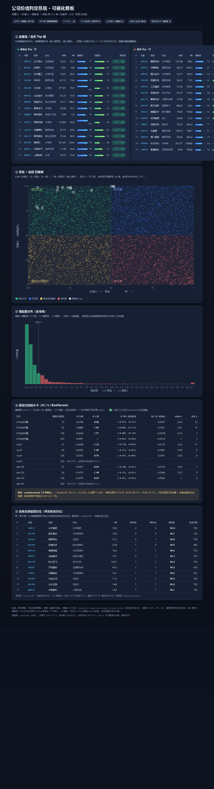

# 公司价值判定系统 (Company Value & Mispricing)

[](https://www.python.org/)
[](LICENSE)
[](requirements.txt)

这是一个判断 A 股公司"贵不贵、值不值"的研究原型。它把估值这件事拆成三段可验证的流程：先用几套不互相依赖的口径算出质量分和估值分，再看这些分数对未来收益有没有预测力，最后按交易成本和统计门槛决定到底能不能下结论。做不到显著，它就直说做不到，而不是从噪声里挑一个好看的数当结论。

项目只依赖 numpy 和 Python 标准库，刻意不用 pandas、scipy、sklearn，因为这套东西的重点是可复现，不是跑分。仓库里不含数据库，真实运行需要你自己准备一份符合结构约定的 SQLite 库。



上面这张图是 `board/valuation_board.html` 的样子。它是一个单文件看板，数据内嵌在 HTML 里，双击就能离线打开，也能直接发给别人，不装 Python、不连库、不联网。图里的快照日是 2026-10-12。

## 目录结构

代码分三层。`core/` 只接收内存数据，负责所有算法，不碰文件也不碰数据库；`dataio/` 是唯一读写数据库的地方，向 `core/` 吐 dict 和 numpy 数组；文档、示例、看板单独一层。根目录只保留很薄的入口脚本，做参数解析然后调下层。依赖方向是单向的，`core/` 不 import `dataio/`，所以不存在循环导入。

```
company-value-system/
├─ core/          算法层：stats / valuation / quality / testing / percentile / report
├─ dataio/        数据接口层：paths（路径与只读连接）、astock（读取接口）、schema.md
├─ docs/          文档：研究方案、数据边界、安装与使用说明、优化报告、BUG 报告
├─ examples/      demo.py 与脱敏样例数据
├─ board/         看板生成脚本与生成好的 HTML
├─ mispricing_screener_v2.py     主入口：多法内在价值 + 错配 + 检验 + 历史分位
├─ quality_value_screener_v2.py  质量 + 估值双因子排序
├─ valuation_percentile.py       自身历史估值分位
├─ demo.py                       薄壳，转调 examples/demo.py
├─ 说明书.md                     面向拿到这个文件夹的人的操作手册
└─ README.md / README.en.md / requirements.txt / LICENSE
```

## 快速开始

只要 numpy，其余全是标准库。

```bash
python -m pip install -r requirements.txt
python demo.py
```

`demo.py` 不需要数据库，它读 `examples/data/sample_valuation_snapshot.csv` 这份手造的脱敏样例，跑一遍行业相对倍数法加秩合成错配，打印一张排序表，最后输出 `DEMO OK ✔`（Windows 的 GBK 控制台会自动降级成 `DEMO OK √`，属正常）。看到这行就说明环境装好了。

Windows 上 `python` 和 `py -3.12` 两种叫法都行，macOS 和 Linux 一般用 `python3`。更细的跨平台步骤见 `docs/安装说明.md`。

## 跑真实数据

仓库不带数据库，`*.db` 和大 `*.csv` 都在 `.gitignore` 里。要跑全市场，先准备两个 SQLite 库，只读使用：

`astock.db` 放行情、财务、估值快照、行业和股本；`valuation_hist.db` 放逐日历史估值序列。字段和单位约定在 `dataio/schema.md`，按那份约定落库就能直接跑，不用改脚本。路径可以用 `--db` / `--hist-db` 指定，也可以放 `data/` 下，或者设环境变量 `ASTOCK_DB`。

```bash
# 全市场：错配 + 检验 + 历史分位
python mispricing_screener_v2.py --mode both --db data/astock.db --hist-db data/valuation_hist.db --out v2_out.txt

# 只看某几只票。过滤的只是显示，分位和错配仍按全池算
python mispricing_screener_v2.py --mode value --codes 600519,000858 --out one.txt

# 质量 + 估值排序，附带写出通过质量关的清单
python quality_value_screener_v2.py --mode both --top 40 --watchlist watchlist.csv --out qv_out.txt

# 自身历史估值分位
python valuation_percentile.py --hist-db data/valuation_hist.db --top 25 --out pct_out.txt
```

看板用 `board/make_board.py` 生成，把结果内嵌成单个 HTML：

```bash
python board/make_board.py --db data/astock.db --out board/valuation_board.html
```

`board/GH_PAGES.md` 里写了怎么把这个 HTML 挂到 GitHub Pages，三步就能发布。

## 结果怎么读

估值模式输出里，`IV_A`、`IV_B`、`IV_C` 是三套内在价值：行业 PE 中位数乘年化 EPS、年化 EPS 除以折现率（零增长 DCF 的特例）、行业 PB 中位数乘每股净资产。`mispr` 是错配度，取值为 0 到 100 的池内秩百分位，大于 50 偏贵、小于 50 偏便宜。它不是价差本身，只是价差在全市场里的排名。

检验模式输出里，`IC_mean` 是横截面秩相关系数的均值，`IC_t` 是它的 t 值，`IC95%CI` 是自举得到的置信区间，`Q5-Q1净` 是便宜组减贵组并扣掉往返成本后的收益，`alpha` 是这组价差对市场因子回归后的截距。表头的 Bonferroni 临界值把显著性门槛按代理数乘期限数收紧，跨过它才算过关。

`undetermined` 是这套系统最常给出的结论。它表示用现有数据判不了，不是判成无效。判定线要求独立样本够多、扣费后的置信区间下界大于零，每条都满足才会写"有效"。历史不够长的时候，置信区间必然很宽，多数组合过不了这条线。

## 现在的结论

当前结论是 undetermined。

这不是没干成，而是该有的裁决。数据层面有两个硬约束：全市场完整日 K 只有约 276 个交易日（2025-08-19 起），12 个月期限的非重叠样本基本为零；估值快照只有 4 个交易日，所以 PE、PB 的历史分位在快照口径下不可用。加上没有账面价值、现金流、股利和负债字段，标准 DCF、RIM、DDM 都没法诚实实现，绝对估值只能用盈利资本化做代理，假设很强。

与其拿一个 alpha 接近零的价差冒充超额收益，不如如实写 undetermined。完整的局限清单在 `docs/数据边界.md`，说明书的最后一节也照实抄了一遍。

## 文档

`说明书.md` 是操作手册，从装环境到读输出一份走完，也写了交付前自检发现的问题。`README.en.md` 是英文版。其余文档：`docs/使用说明.md` 讲命令和输出逐列的含义，`docs/安装说明.md` 讲跨平台安装，`docs/数据边界.md` 讲本机能支撑什么、不能支撑什么，`docs/研究方案.md` 是方法设计，`docs/优化报告-v2.md` 和 `docs/诊断-质量与估值排序器.md` 记录了迭代过程。

## 许可证

MIT，见 `LICENSE`。

## 免责声明

这是一个研究方法论原型，只承诺流程可复现，不承诺任何收益，也不构成投资建议。文中所有数字都来自本地真实运行，并标注了快照日和财务期。

作者：mkua030712-ship-it / 刘明豪
